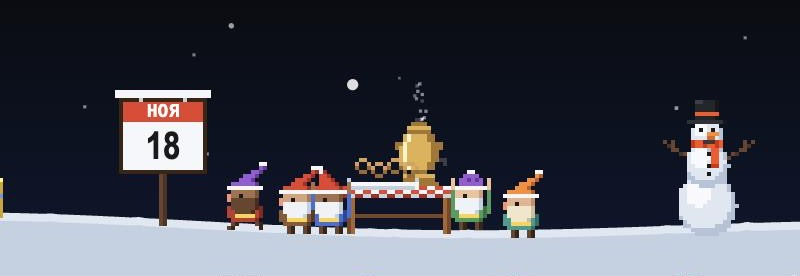

# site-holidays

**Праздничные режимы для сайтов · Holiday modes for websites**

Сделано командой [FolloTeam](https://folloteam.ru) · Made by [FolloTeam](https://folloteam.ru)

[Русский](#русский) · [English](#english)



---

## Русский

Праздники, эффекты и пасхалки для сайтов: снег, гирлянды, новогодний логотип, сцена с ёлкой,
гномики, мини-игра. Здесь их разрабатывают, а сайты забирают готовые версии одной командой.

### Как это устроено

- Сайт подключает **один загрузчик** — `site-holidays.js`. Подключил один раз — и всё.
- Загрузчик смотрит на дату, адрес страницы и пасхалку и сам подгружает нужный праздник из `holidays/`.
  Вне праздников он почти ничего не весит и ничего не грузит.
- Праздники не знают вёрстку сайта: сами находят кнопки, карточки и картинки и подстраиваются под любую страницу.
  Новые страницы и переделанный дизайн не требуют доработок.
- Без зависимостей и сборки: обычные JS-файлы и картинки.

### Праздники

| id | Когда | Модуль |
|---|---|---|
| `valentine` | 10–15 февраля | [`holidays/valentine.js`](holidays/valentine.js) — День влюблённых: сердечки, шлейф за курсором, салют из сердец по клику, логотип с сердечками или стрелой Купидона; внизу человечки: свидание, букет, Купидон, валентинка, серенада |
| `lunar` | за 2 дня до китайского Нового года и 7 дней после (даты 2026–2036 в модуле) | [`holidays/lunar.js`](holidays/lunar.js) — фонарики под шапкой, монетки и красные конверты, хлопушки по клику, логотип с фонариками или монетками; внизу человечки: танец дракона, хлопушки, красные конверты, танец льва, небесные фонарики |
| `winter` | 1 декабря – конец февраля | [`holidays/winter.js`](holidays/winter.js) — зима и Новый год |

Когда даты совпадают, побеждает праздник выше в таблице: в День влюблённых и в китайский Новый год вместо зимы показывается он.

Общие файлы: [`holidays/scene.js`](holidays/scene.js) — движок сцены внизу страницы (земля, человечки, сценки; человечки смотрят на курсор, от клика подпрыгивают, от трёх быстрых кликов падают), [`holidays/logo.js`](holidays/logo.js) — праздничный SVG поверх текстового знака `>>FT_`. Модули праздников подгружают их сами.

### Быстрый старт

```sh
git clone https://github.com/FolloGit/site-holidays.git
./site-holidays/install.sh путь/к/сайту/assets      # → assets/holidays/…
```

На каждой странице перед `</body>`:

```html
<script src="assets/holidays/site-holidays.js?v=1.1.0" defer></script>
```

Готово: с 1 декабря на сайте пойдёт снег. Проверить сейчас — открыть страницу с `?holiday=winter`.

### Обновление сайта

Положите в сайт скрипт [`tools/update-holidays.sh`](https://github.com/FolloTeam/site/blob/Prod/tools/update-holidays.sh)
(из репозитория сайта FolloTeam) и запускайте:

```sh
sh tools/update-holidays.sh            # последняя версия
sh tools/update-holidays.sh v1.1.0     # конкретная версия
```

Скрипт держит копию этого репозитория рядом с сайтом (`../site-holidays`), ставит файлы в `assets/holidays/`
и меняет `?v=` в подключении на всех страницах. Останется проверить и закоммитить сайт.

### Включение и выключение

| Как | Что делает |
|---|---|
| по дате | праздник включается сам в свой сезон (по часам посетителя) |
| `?holiday=winter` | включить для проверки |
| `?holiday=off` | выключить всё |
| `?winter=1` / `?winter=0` | то же для зимы (старый вариант) |
| `data-holiday-egg="winter"` | невидимая кнопка-пасхалка: включает праздник в любое время года, повторное нажатие выключает |
| кнопка-снежинка внизу слева | посетитель может выключить зиму; выбор запоминается |

### Настройки сайта

Необязательно, перед подключением загрузчика:

```html
<script>
  window.SITE_HOLIDAYS = {
    off: ['winter'],              // праздники, которые этому сайту не нужны
    winter: { favicon: false }    // настройки модуля зимы
  };
</script>
```

### Зима и Новый год

- **Снег** — погода меняется сама: тихий снег, снегопад, метель вбок. Хлопья двигаются вместе со страницей при прокрутке.
- **Сугробы** на кнопках, карточках и картинках с учётом скруглённых углов. Курсором снег можно смахнуть.
- **Гирлянда** под шапкой сайта, качается от курсора.
- **Новогодний логотип** — текстовый «>>FT_» в шапке становится знаком с шапкой Санты, оленями или гирляндой.
- **Сцена внизу страницы** — ёлка, календарь, подарки, снеговики семи видов и гномики, все разные.
- **Мини-игра** — подарки и снеговиков можно таскать и кидать. Подарок ломает снеговика, гномики приходят чинить.
  Двойной клик по подарку разбивает его, и выпадают предметы разной редкости — гномики их подбирают.
- **События** запускаются сами:

| Событие | Что происходит |
|---|---|
| `build` | двое гномиков катают комья и лепят снеговика |
| `repair` | чинят сломанного снеговика и возвращают шапку |
| `snowballs` | игра в снежки |
| `sled` | насыпают горку и катаются на санках |
| `prank` | шалость: передвинуть или пнуть снеговика |
| `gifts` | обмен подарками |
| `tea` | чаепитие с самоваром и баранками — выносят стол, пируют, играют и всё уносят |
| `loot` | подбирают добычу из разбитых подарков |
| `calendar` | в полночь гномик отрывает листок календаря |
| `party` | новогодние гуляния и салют в ночь на 1 января |
| `santa` | Санта на санях пролетает над страницей и роняет подарок |
| `fireworks` | салют |

Разметка, которую понимает модуль:

| Атрибут | Зачем |
|---|---|
| `data-winter-ignore` | на этом элементе снег не копится |
| `data-winter-logo="#ff4f12"` | текстовый знак «>>FT_», который зимой становится новогодним; оранжевый в знаке перекрашивается в указанный цвет |

Консоль (удобно на презентациях):

```js
ftWinter.event('tea')        // запустить событие (список — ftWinter.events())
ftWinter.event('midnight')   // гномик прибежит и перевернёт календарь
ftWinter.openGift()          // разбить подарок
ftWinter.logo('reindeer')    // santa | reindeer | garland
ftWinter.weather('blizzard') // calm | snow | blizzard
```

### Демо

[`demo/index.html`](demo/index.html) — страница с кнопками всех событий. Любой статический сервер из корня репозитория:

```sh
python3 -m http.server 8092      # → http://localhost:8092/demo/?holiday=winter
```

### Как добавить праздник

1. Модуль `holidays/<id>.js` — самостоятельный скрипт (за образец — `winter.js`).
2. Строчка в списке `HOLIDAYS` в `site-holidays.js`: `{ id, file, months }` или `when: function (date) {…}` для точных дат.
3. Картинки — в `img/`, кнопки — в демо.

### Выпуск версии

1. Поднять `VERSION` в `site-holidays.js` (и версию модуля в его шапке).
2. Проверить на демо.
3. Записать изменения в «Версии», закоммитить, поставить тег и запушить:
   `git tag -a vX.Y.Z -m "site-holidays X.Y.Z" && git push --follow-tags`
4. На сайтах — `sh tools/update-holidays.sh`.

---

## English

Holidays, effects and easter eggs for websites: snow, garlands, a New Year logo, a scene with a tree, gnomes
and a mini-game. They are developed here, and sites pull ready-made versions with one command.

### How it works

- A site includes **one loader**, `site-holidays.js`, and never has to touch it again.
- The loader checks the date, the page URL and the easter egg, then loads the right holiday from `holidays/`.
  Outside holidays it weighs almost nothing and loads nothing.
- Holidays don't know the site's markup. They find buttons, cards and images on their own and adapt to any page,
  so new pages and redesigns need no extra work.
- No dependencies and no build step: plain JS files and images.

### Holidays

| id | When | Module |
|---|---|---|
| `valentine` | February 10–15 | [`holidays/valentine.js`](holidays/valentine.js) — Valentine's Day: hearts, a cursor trail, heart bursts on click, a logo with hearts or Cupid's arrow; people at the bottom: a date, flowers, Cupid, a valentine card, a serenade |
| `lunar` | 2 days before Lunar New Year to 7 days after (dates for 2026–2036 in the module) | [`holidays/lunar.js`](holidays/lunar.js) — lanterns under the header, coins and red envelopes, firecrackers on click, a logo with lanterns or coins; people at the bottom: dragon dance, firecrackers, red envelopes, lion dance, sky lanterns |
| `winter` | December 1 – end of February | [`holidays/winter.js`](holidays/winter.js) — winter and New Year |

When dates overlap, the holiday higher in the table wins: on Valentine's Day and Lunar New Year it replaces winter.

Shared files: [`holidays/scene.js`](holidays/scene.js) is the bottom scene engine (ground, people, plays; people turn to the cursor, hop on click, fall over after three quick clicks), [`holidays/logo.js`](holidays/logo.js) lays a holiday SVG over the `>>FT_` text mark. Holiday modules load them on their own.

### Quick start

```sh
git clone https://github.com/FolloGit/site-holidays.git
./site-holidays/install.sh path/to/site/assets      # → assets/holidays/…
```

On every page, before `</body>`:

```html
<script src="assets/holidays/site-holidays.js?v=1.1.0" defer></script>
```

That's it: from December 1 it snows on the site. To check it now, open a page with `?holiday=winter`.

### Updating a site

Add [`tools/update-holidays.sh`](https://github.com/FolloTeam/site/blob/Prod/tools/update-holidays.sh)
(from the FolloTeam site repository) to the site and run:

```sh
sh tools/update-holidays.sh            # latest version
sh tools/update-holidays.sh v1.1.0     # a specific version
```

The script keeps a copy of this repository next to the site (`../site-holidays`), installs the files into
`assets/holidays/` and bumps `?v=` in the include on every page. Then check and commit the site.

### Turning holidays on and off

| How | What it does |
|---|---|
| by date | a holiday turns on by itself in its season (visitor's local time) |
| `?holiday=winter` | force it on for testing |
| `?holiday=off` | turn everything off |
| `?winter=1` / `?winter=0` | same for winter (legacy) |
| `data-holiday-egg="winter"` | hidden easter-egg button: turns the holiday on any time of year, press again to turn it off |
| snowflake button, bottom left | lets visitors turn winter off; the choice is remembered |

### Site options

Optional, before the loader script:

```html
<script>
  window.SITE_HOLIDAYS = {
    off: ['winter'],              // holidays this site does not want
    winter: { favicon: false }    // winter module options
  };
</script>
```

### Winter and New Year

- **Snow.** The weather changes by itself: light snow, snowfall, a sideways blizzard. Flakes move with the page when you scroll.
- **Snow piles** on buttons, cards and images, following rounded corners. You can sweep snow off with the cursor.
- **Garland** under the site header that sways when the cursor passes.
- **New Year logo.** The text mark ">>FT_" in the header turns into a version with a Santa hat, reindeer or a garland.
- **Scene at the bottom of the page:** a tree, a calendar, gifts, seven kinds of snowmen and gnomes that all look different.
- **Mini-game.** Drag and throw gifts and snowmen. A gift breaks a snowman, and gnomes come to fix it.
  Double-click a gift to break it open: items of different rarity fall out, and gnomes pick them up.
- **Events** start on their own:

| Event | What happens |
|---|---|
| `build` | two gnomes roll snowballs and build a snowman |
| `repair` | they fix a broken snowman and put its hat back |
| `snowballs` | a snowball fight |
| `sled` | they build a hill and sled down it |
| `prank` | a prank: move or kick a snowman |
| `gifts` | a gift exchange |
| `tea` | tea with a samovar and bagels: they bring a table, feast, play and carry everything away |
| `loot` | they pick up loot from broken gifts |
| `calendar` | at midnight a gnome tears a page off the calendar |
| `party` | New Year's Eve party with fireworks |
| `santa` | Santa's sleigh flies over the page and drops a gift |
| `fireworks` | fireworks |

Markup the module understands:

| Attribute | Purpose |
|---|---|
| `data-winter-ignore` | snow never piles up on this element |
| `data-winter-logo="#ff4f12"` | the ">>FT_" text mark that becomes festive in winter; orange in the mark is recoloured to the given colour |

Console (handy for demos):

```js
ftWinter.event('tea')        // run an event (list: ftWinter.events())
ftWinter.event('midnight')   // a gnome runs over and flips the calendar
ftWinter.openGift()          // break a gift open
ftWinter.logo('reindeer')    // santa | reindeer | garland
ftWinter.weather('blizzard') // calm | snow | blizzard
```

### Demo

[`demo/index.html`](demo/index.html) has buttons for every event. Serve the repository root with any static server:

```sh
python3 -m http.server 8092      # → http://localhost:8092/demo/?holiday=winter
```

### Adding a holiday

1. Create a module `holidays/<id>.js`, a self-contained script (use `winter.js` as the template).
2. Add an entry to `HOLIDAYS` in `site-holidays.js`: `{ id, file, months }`, or `when: function (date) {…}` for exact dates.
3. Put images in `img/` and add buttons to the demo.

### Releasing a version

1. Bump `VERSION` in `site-holidays.js` (and the module version in its header).
2. Check it on the demo page.
3. Note the changes under "Versions", commit, tag and push:
   `git tag -a vX.Y.Z -m "site-holidays X.Y.Z" && git push --follow-tags`
4. On each site, run `sh tools/update-holidays.sh`.

---

## Структура · Layout

```
site-holidays.js    загрузчик — единственное, что подключают сайты · the loader, the only file sites include
holidays/           модули праздников · holiday modules (winter.js, valentine.js, lunar.js, scene.js, logo.js)
img/                картинки праздников · holiday images
demo/index.html     демо-страница · demo page
docs/               картинки для README · README images
install.sh          установка на сайт · install into a site
```

## Версии · Versions

- **1.1.0**
  - Новые праздники: День влюблённых (`valentine.js`) и китайский Новый год (`lunar.js`) — эффекты, праздничный логотип `>>FT_`, сцена с человечками и сценками внизу страницы.
  - Общие файлы: `scene.js` (сцена внизу страницы) и `logo.js` (праздничный логотип).
  - Зима `winter.js` 2.1.0: Санта, искры и салют прокручиваются вместе со страницей; гномики реагируют на курсор — поворачиваются, подпрыгивают от клика, падают от трёх быстрых кликов.
  - New holidays: Valentine's Day (`valentine.js`) and Lunar New Year (`lunar.js`) — effects, a festive `>>FT_` logo, a bottom scene with people and little plays.
  - Shared files: `scene.js` (bottom scene) and `logo.js` (holiday logo).
  - Winter `winter.js` 2.1.0: Santa, sparks and fireworks scroll with the page; gnomes react to the cursor — they turn, hop on click and fall over after three quick clicks.
- **1.0.0**
  - Пакет site-holidays: загрузчик и модуль зимы `winter.js` 2.0.0. Снег двигается вместе со страницей; события гномиков; Санта, салют, добыча из подарков; виды снеговиков и гномиков.
  - The site-holidays package: a loader and the `winter.js` 2.0.0 module. Snow moves with the page; gnome events; Santa, fireworks, loot from gifts; snowman and gnome variety.
- **ft-winter 1.x–2.0.0**
  - Зимний режим до пакета: снег, сугробы, гирлянда, сцена с ёлкой, гномики, мини-игра, новогодний логотип, пасхалка.
  - Winter mode before the package: snow, piles, garland, tree scene, gnomes, mini-game, New Year logo, easter egg.

---

© FolloTeam · [folloteam.ru](https://folloteam.ru)
